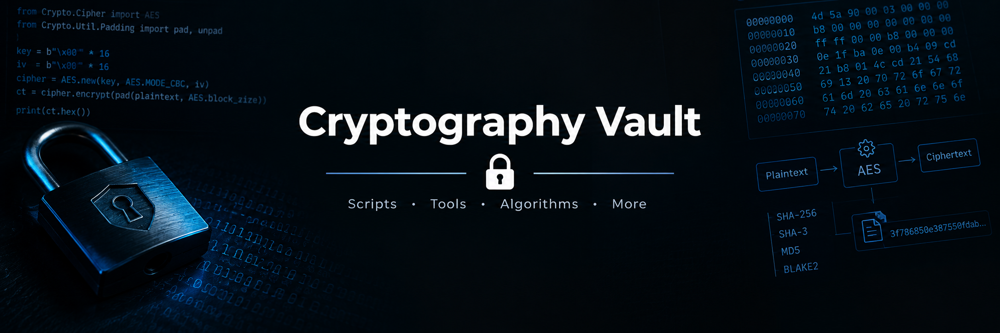

# Cryptography Vault

  

  Cryptography scripts, tools, algorithms, and experiments.

  
  
  

---

A collection of cryptography-related scripts, utilities, implementations, and experiments covering encryption, hashing, encoding, and cryptographic analysis.

## Scope

- Encryption and decryption utilities
- Hashing algorithms and data integrity
- Encoding, decoding, and data transformations
- Cryptographic implementations and experiments
- CTF challenges and security research

## Status

Work in progress. Tools and experiments are added and refined over time.

---

  Explore algorithms. Understand the math. Build better tools.

